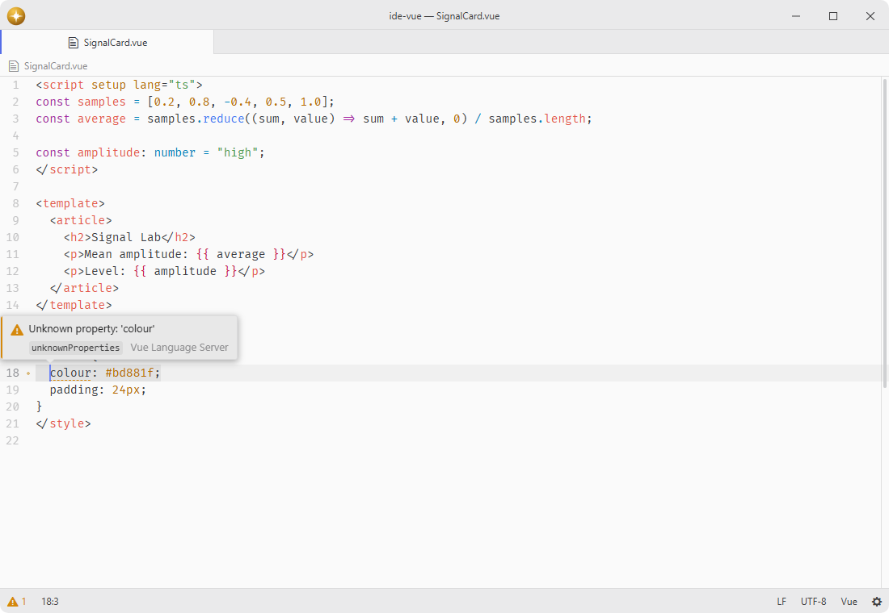

# ide-vue

Vue language-server adapter.

Registers the bundled Vue Language Server with `ide`, providing diagnostics, completion, navigation, symbols, formatting, refactoring, hints, and semantic highlighting across Vue single-file components.

## Features

- **Bundled server**: pins `@vue/language-server` exactly, with optional custom server and TypeScript SDK paths.
- **Managed upgrade**: installs a newer server from npm when you want one, and removing it returns to the bundled copy.
- **Native TypeScript 7**: runs the upstream `typescript-native-bridge` and matching `@vue/typescript-plugin` in a companion process, answering the server's custom `tsserver/request` notifications for project and component intelligence.
- **Whole-SFC intelligence**: serves Vue templates together with their TypeScript, JavaScript, HTML, CSS, SCSS, and Less blocks.
- **Navigation and structure**: follows components, props, bindings, styles, and script symbols and supplies references and document symbols.
- **Editing**: formats SFC blocks, renames symbols, offers fixes and refactorings, and supplies inlay hints.
- **Configuration**: controls component and prop casing, embedded formatting, automatic insertions, TypeScript imports, and Vue and TypeScript hints.
- **Feature switches**: every advertised shared IDE capability can be handed to another server serving the same Vue file.

## Installation

To install `ide-vue` search for it in the Install pane of the Lumine settings, or run the command `lumine --install lumine-code/ide-vue`.

Install `ide` first.

## Usage

A managed server installs a matching Vue server and plugin together with the pinned TypeScript native bridge. A custom server uses the bundled SDK and plugin unless a TypeScript SDK path is configured. SDK paths must select `typescript-native-bridge` backed by TypeScript 7; the stock TypeScript 7 package provides no tsserver for Vue's companion protocol. Remove an older managed TypeScript 6 installation and install it again to migrate.

The adapter handles a released-snapshot documentation error in bridge 19 by querying the current native checker for the same symbol's documentation and JSDoc tags. Other errors propagate normally, and native symbol identity, required props and boolean types remain intact. This integration uses the published upstream SDK without modifying its installed files.

## Services

- `ide`: consumed to register the Vue adapter with the editor's language-server client.

## Contributing

Got ideas to make this package better, found a bug, or want to help add new features? Just drop your thoughts on GitHub. Any feedback is welcome!
